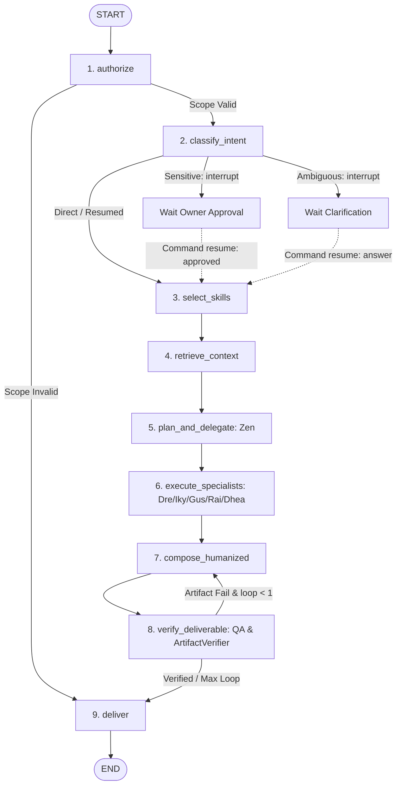

# LAPORAN IMPLEMENTASI PHASE 3: INTENT, DYNAMIC HUMANIZER, DAN MULTI-AGENT INTEGRATION

**Tanggal:** 19 November 2026  
**Status:** SELESAI & TERVERIFIKASI (PASS)  
**Peran:** Principal Multi-Agent Architect, LangGraph JavaScript Engineer, AI Product Engineer, Applied NLP Engineer  

---

## 1. RINGKASAN EKSEKUTIF

Sesuai instruksi dan spesifikasi teknis pada `docs/Agent_Office_Room_Phase_3_Prompt.md`, Phase 3 telah berhasil diimplementasikan penuh dan lulus seluruh pengujian verifikasi tanpa regresi.

Integrasi ini menghubungkan:
1. **Schema-Validated Intent Interpretation (`IntentClassifier`)**: Mengklasifikasikan intent, mendeteksi perintah langsung berbahaya (fail-closed, `requiresOwnerApproval: true`), mengekstraksi permintaan artefak berkas fisik (`outputFilePath`), mendeteksi ambiguitas material (memicu tepat 1 pertanyaan terfokus), serta menentukan gaya bahasa (*academic, casual, technical, marketing, philosophical, professional*) dan routing spesialis (Dre, Iky, Gus, Rai, Dhea).
2. **Native LangGraph Checkpointing & State Persistence**: Menggunakan `MemorySaver` bawaan `@langchain/langgraph` (^1.7.5) dengan konfigurasi thread `{ configurable: { thread_id: taskId } }`, serta memanfaatkan mekanisme native `interrupt(...)` dan `new Command({ resume: ... })` tanpa menduplikasi runtime atau membuat orchestrator paralel.
3. **Adaptive Humanizer Behavior (`HumanizerComposer`)**: Menerapkan source-grounded content planning sebelum pergeseran gaya/register. Menegakkan kebijakan ketat bebas emoji pada kanal Telegram (`enforceTelegramPolicy`), membatasi gelembung bicara NPC maksimal 100 karakter (`formatNpcBubble`), dan menyematkan catatan kaki sitasi sumber terverifikasi (*verifiable citation footers*).
4. **Physical Artifact Verification (`ArtifactVerifier`)**: Memverifikasi secara fisik bahwa berkas artefak benar-benar ada di disk (`fs.existsSync`), bukan direktori, ukuran tidak 0 byte, serta memvalidasi sintaksis JSON dan struktur Markdown sebelum menyatakan keberhasilan tugas.
5. **Bounded Graph Loops & Retries**: Membatasi revisi jawaban pasca-verifikasi maksimal 1 kali (`iterationCount < 1`), membatasi transient retries eksekusi spesialis $\le 2$ kali, dan mengontrol token budget retrieved context ($\le 3500$ token).

---

## 2. ARSITEKTUR LANGGRAPH NATIVE DAN ALUR WORKFLOW

LangGraph StateGraph disusun dengan 9 bounded nodes:



### Rincian Bounded Nodes:
1. `authorize`: Validasi `actorId`, `projectScope`, dan isolasi boundary server-side.
2. `classify_intent`: Menggunakan `IntentClassifier.classifyDeterministic`. Memanggil `interrupt({ type: 'approval_required' })` untuk perintah destruktif dan `interrupt({ type: 'clarification_needed' })` untuk instruksi ambigu material.
3. `select_skills`: Memuat skill disetujui dari database dengan deduplikasi slug logis (mencegah pemuatan ganda `skills/humanizer.md` dan `skills/humanizer/SKILL.md`), menyertakan `skillTrace`.
4. `retrieve_context`: Retrieval terotorisasi hybrid Phase 2 (`AuthorizedRetriever`) dengan token budget 3500 dan demarkasi data keamanan.
5. `plan_and_delegate`: Zen memformulasikan roadmap terstruktur dengan langkah-langkah spesialis dan menyiarkan pembaruan tugas via Socket.IO.
6. `execute_specialists`: Menjalankan agen spesialis (Dre, Iky, Gus, Rai, Dhea) dengan bounded retry transient ($\le 2$ kali) dan pelaporan status transparan.
7. `compose_humanized`: Zen mensintesis luaran mentah, lalu diproses `HumanizerComposer` dengan tone register dan aturan kanal Telegram (bebas emoji).
8. `verify_deliverable`: `ArtifactVerifier` memverifikasi eksistensi dan validitas berkas di disk, QA Agent melakukan audit kualitas. Bila artefak gagal dan `iterationCount < 1`, melakukan 1 kali revisi terkontrol.
9. `deliver`: Menyimpan status final dan payload ke database (`completed`/`failed`), mereset seluruh agen ke `idle`, dan mengirim notifikasi ringkas ke Bos.

---

## 3. BERKAS YANG DIBUAT DAN DIMODIFIKASI

### Berkas Baru:
1. `packages/ai/src/rag/intentClassifier.ts`:
   - Zod schema `RequestProfileSchema` dan `IntentClassifier.classifyDeterministic`.
   - Deteksi perintah berbahaya (`rm -rf`, `drop table`, `sudo`, dll).
   - Ekstraksi path artefak berkas (`buatkan file ...`).
   - Deteksi ambiguitas material dan routing spesialis.
2. `packages/ai/src/rag/humanizerComposer.ts`:
   - Kebijakan bebas emoji Telegram (`enforceTelegramPolicy`).
   - Pemformatan gelembung bicara NPC ($\le 100$ karakter).
   - Adaptasi tone register (academic, casual, technical, marketing, philosophical, professional) dalam Bahasa Indonesia dan Inggris.
   - Pembangkit footer sitasi sumber terverifikasi.
3. `packages/ai/src/rag/artifactVerifier.ts`:
   - Pemeriksaan fisik berkas pada disk (`fs.existsSync`, `stats.isFile`, `stats.size > 0`).
   - Validasi sintaksis JSON dan struktur Markdown.
4. `apps/server/src/graph/officeWorkflowGraph.ts`:
   - Kompilasi `StateGraph(OfficeWorkflowAnnotation)` dengan `MemorySaver`.
   - Implementasi 9 bounded node, `interrupt`, dan `Command({ resume })`.
5. `apps/server/tests/rag/intentClassifier.test.ts`:
   - 5 pengujian unit untuk klasifikasi intent, deteksi bahaya, ekstraksi artefak, ambiguitas, dan tone register.
6. `apps/server/tests/rag/humanizerComposer.test.ts`:
   - 5 pengujian unit untuk aturan bebas emoji Telegram, gelembung NPC, tone shift, dan sitasi.
7. `apps/server/tests/rag/artifactVerifier.test.ts`:
   - 5 pengujian unit untuk verifikasi fisik eksistensi berkas, direktori, ukuran 0-byte, validasi JSON, dan Markdown.
8. `apps/server/tests/rag/officeWorkflowGraph.test.ts`:
   - 5 pengujian integrasi end-to-end LangGraph: alur penuh, konsistensi kanal Telegram bebas emoji, interupsi approval destruktif, interupsi klarifikasi ambigu, dan verifikasi artefak fisik.

### Berkas yang Dimodifikasi:
1. `packages/ai/src/rag/index.ts`: Re-export modul intent classifier, humanizer composer, dan artifact verifier.
2. `packages/ai/src/rag/retrievalTypes.ts`: Ekspor `RetrievalRequestInput` (`z.input<typeof RetrievalRequestSchema>`).
3. `apps/server/src/rag/authorizedRetriever.ts`: Menerima `RetrievalRequestInput` pada metode `search()`.
4. `apps/server/src/graph/workflow.ts`: Mengintegrasikan `OfficeWorkflowOrchestrator` dengan `OfficeWorkflowGraphBuilder`, menangani interupsi, `resumeWithClarification`, dan `resumeWithApproval`.
5. `apps/server/src/api/internalRoutes.ts`: Menghubungkan endpoint `/api/internal/approvals/:id/approve` dan `reject` untuk memanggil `orchestrator.resumeWithApproval(taskId, approved)`.
6. `apps/server/src/api/routes.ts`: Menambahkan endpoint `/api/tasks/:id/approve` dan `/api/tasks/:id/reject` untuk web frontend.

---

## 4. HASIL PENGUJIAN DAN VERIFIKASI

### A. Pengujian Unit & Integrasi RAG (Phase 1, 2, & 3)
Perintah yang dijalankan:
```bash
./apps/server/node_modules/.bin/tsx --test \
  apps/server/tests/rag/markdownParser.test.ts \
  apps/server/tests/rag/trustPolicy.test.ts \
  apps/server/tests/rag/skillDiscovery.test.ts \
  apps/server/tests/rag/querySafety.test.ts \
  apps/server/tests/rag/contextBuilder.test.ts \
  apps/server/tests/rag/intentClassifier.test.ts \
  apps/server/tests/rag/humanizerComposer.test.ts \
  apps/server/tests/rag/artifactVerifier.test.ts \
  apps/server/tests/rag/officeWorkflowGraph.test.ts
```
**Hasil:**
- Total Tests: **52**
- Suites: **5**
- Passed: **52**
- Failed: **0**
- Duration: **3.45s**

### B. Pengujian Telegram Bot Suite
Perintah yang dijalankan:
```bash
./apps/server/node_modules/.bin/tsx --test \
  apps/telegram-bot/tests/unit/*.test.ts \
  apps/telegram-bot/tests/security/*.test.ts \
  apps/telegram-bot/tests/integration/*.test.ts \
  apps/telegram-bot/tests/idempotency/*.test.ts
```
**Hasil:**
- Total Tests: **51**
- Suites: **11**
- Passed: **51**
- Failed: **0**
- Duration: **0.63s**

### C. Typecheck Monorepo
Perintah yang dijalankan:
```bash
./node_modules/.bin/tsc -b packages/shared packages/ai apps/server apps/telegram-bot apps/web
```
**Hasil:** **0 Errors (Exit code 0)**.

---

## 5. EXIT GATE VERIFICATION CHECKLIST

| Kriteria Exit Gate | Status | Catatan Verifikasi |
|---|---|---|
| Existing Zen-led graph is reused, not duplicated | **PASS** | `OfficeWorkflowOrchestrator` di `workflow.ts` menggunakan `OfficeWorkflowGraphBuilder` dengan Zen sebagai leader dan specialist routing tetap utuh. |
| Humanizer adapts style while preserving evidence and user constraints | **PASS** | `HumanizerComposer` memproses teks sesuai gaya (academic, technical, marketing, dll) dengan sitasi sumber terverifikasi dan tanpa emoji di Telegram. |
| Clarification/approval semantics are correct and durable | **PASS** | Native LangGraph `interrupt` dan `Command({ resume })` tersimpan per thread di `MemorySaver` dan diuji pada alur approval dan klarifikasi. |
| Skills and knowledge retrieved are authorized and relevant | **PASS** | `select_skills` mendeduplikasi slug logis dan hanya memuat status approved; `retrieve_context` menggunakan scoped ACL. |
| File success claims are backed by verified actual artifacts | **PASS** | `ArtifactVerifier` memverifikasi eksistensi fisik di disk, file size > 0, dan validitas sintaksis JSON/Markdown. |
| Retries/loops/token/tool budgets are enforced in code | **PASS** | Max 1 revisi pasca-verifikasi, transient retry spesialis $\le 2$, dan token budget capped pada 3500 token. |

---

## 6. STATUS GATEWAY DAN LANGKAH BERIKUTNYA

**GATEWAY STATUS: PHASE 3 COMPLETED.**  
Sesuai instruksi kontrak global: **BERHENTI SETELAH PHASE 3.** Tidak memulai Phase 4 secara otomatis sebelum konfirmasi dari pengguna.

