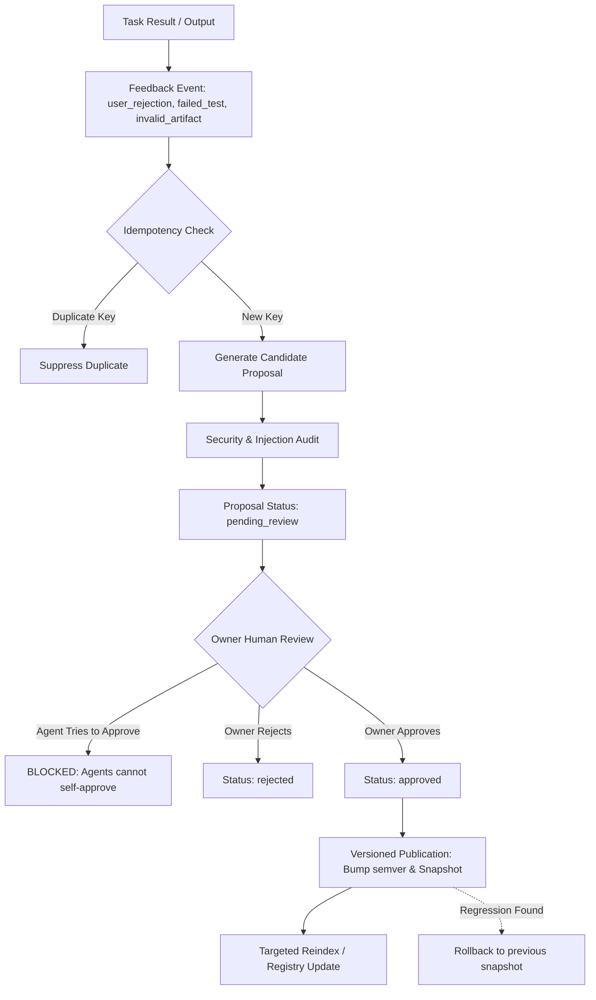

# LAPORAN IMPLEMENTASI PHASE 4: MEMORY AND GOVERNED IMPROVEMENT

**Tanggal:** 19 November 2026  
**Status:** SELESAI & TERVERIFIKASI (PASS)  
**Peran:** Principal AI Memory Architect, Senior Data Governance Engineer, Multi-Agent Reliability Engineer, Security Engineer  

---

## 1. RINGKASAN EKSEKUTIF

Sesuai instruksi dan spesifikasi teknis pada `docs/Agent_Office_Room_Phase_4_Prompt.md` serta penekanan khusus pengguna terkait pemisahan *short-term checkpoint state* dan *long-term knowledge/memory store*, Phase 4 telah berhasil diimplementasikan penuh dan lulus seluruh pengujian verifikasi tanpa regresi.

Peningkatan sistem difokuskan pada peningkatan kualitas retrieval, memori terverifikasi, prosedur/skill terversi, dan kebijakan yang dievaluasi secara terkontrol — **bukan dengan melatih ulang bobot model dasar Gemini (*no model-weight retraining*)**.

---

## 2. PEMISAHAN MEMORI & TAKSONOMI LIMA KATEGORI

Sesuai arahan arsitektural utama:
- **Short-Term Checkpoint State (Working Memory)**: Dikelola secara terpisah oleh LangGraph `MemorySaver` thread state (`thread_id: taskId`) pada graf alur kerja dan Redis session sliding window (maksimal 12 pesan terbaru). Memori ini bersifat sementara (*transient*) dan tidak bocor atau menggembungkan repositori pengetahuan jangka panjang.
- **Long-Term Memory Store**: Dikelola secara persisten di PostgreSQL (`agent_memories` dengan ekstensi ACL dan tata kelola) dan Redis L1 cache, dikelompokkan ke dalam taksonomi:

| Kategori Memori | Deskripsi & Cakupan | Penegakan Tata Kelola |
|---|---|---|
| **1. Working Memory** | State tugas dan sesi percakapan aktif | Disimpan di LangGraph checkpointer & Redis window, terisolasi per thread/sesi |
| **2. Episodic Memory** | Riwayat eksekusi tugas, keputusan, error, dan hasil akhir | Memuat `taskId`, `sourceProvenance`, dan hasil audit QA |
| **3. Semantic / Project Memory** | Fakta terkonfirmasi, SOP proyek, dan konvensi | Memiliki `projectScope`, `visibility`, dan `verificationState` |
| **4. User Preference Memory** | Preferensi eksplisit pengguna (gaya, bahasa, format) | Terikat pada `actorId`, pembaruan otomatis mensupersede nilai lama |
| **5. Procedural Memory** | Skill dan SOP yang telah disetujui (*approved*) | Tersimpan terversi di `skill_registry`, **tidak pernah di-overwrite otomatis** dari percakapan |

---

## 3. TATA KELOLA KEAMANAN & ISOLASI AKSES

1. **Redaksi Rahasia Otomatis (`SecretRedactor`)**:
   - Memindai dan menyunting otomatis kunci API (OpenAI `sk-...`, Google `AIza...`, GitHub `ghp_...`, AWS `AKIA...`, Slack `xox...`), token Bearer/JWT, kata sandi pada connection string database (`postgres://...`), dan *private keys* sebelum ditulis ke memori atau dihitung embedding-nya.
2. **Isolasi Multi-Tenant & Akses Server-Side (`MemoryGovernor`)**:
   - Isolasi ketat antar-tenant (`tenantId`): pengguna tenant A tidak dapat membaca atau menulis memori tenant B.
   - Isolasi memori privat antar-pengguna (`visibility: 'private'` hanya dapat diakses oleh author/pemiliknya).
   - Penegakan izin berbasis peran: peran `guest` tidak dapat menulis memori; peran selain `owner` tidak dapat menulis memori prosedural.
3. **Invarian Non-Promosi (`VerificationState`)**:
   - Asumsi yang dihasilkan model AI atau keluaran penalaran agen **TIDAK PERNAH dipromosikan otomatis menjadi kebenaran proyek (*verified_truth*)**. Status dibatasi sebagai `model_inference` atau `user_claim`. Hanya persetujuan eksplisit pemilik manusia (*owner*) atau pengujian terotomatisasi valid yang dapat menetapkan `verified_truth`.
4. **Siklus Hidup & Retensi (`RetentionPolicy`)**:
   - Mendukung kebijakan `session` (kedaluwarsa 24 jam), `30_days`, `90_days`, dan `permanent`.
   - Pemangkasan otomatis pada pembacaan jika memori telah kedaluwarsa atau di-soft-delete (`deletedAt`).

---

## 4. PIPELINE PENINGKATAN BERKELANJUTAN TERKONTROL (GOVERNED IMPROVEMENT PIPELINE)

Alur tata kelola peningkatan skill dan retrieval diimplementasikan secara ketat:



### Invarian Kunci Tata Kelola:
1. **Tidak Ada Mutasi Skill Otomatis**: Umpan balik negatif atau kegagalan tes **hanya menghasilkan usulan perubahan (`ImprovementProposal`)**, bukan memodifikasi berkas Markdown atau tabel `skill_registry` secara langsung.
2. **Larangan Self-Approval oleh Agen AI**: Zen, Rai, Dhea, atau agen mana pun secara tegas dilarang menyetujui usulan perbaikan mereka sendiri (`reviewerRole !== 'owner'` melempar pengecualian otorisasi). Hanya pemilik manusia (*owner*) yang berwenang meninjau dan menyetujui.
3. **Penerbitan Terversi & Rollback**: Penerbitan usulan yang telah disetujui menaikkan versi semver minor (misal `1.0.0` $\rightarrow$ `1.1.0`), mencatat audit trail, menyimpan snapshot konten sebelumnya, dan menyediakan mekanisme rollback instan jika ditemukan regresi.
4. **Pencegahan Loop Tak Terbatas**:
   - Maksimal 2 usulan perbaikan per tugas (`maxProposalsPerTask = 2`).
   - Maksimal 5 penulisan memori per tugas (`maxWritesPerTask = 5`).
   - Maksimal 1 siklus evaluasi offline per usulan.
   - Maksimal 1 kali siklus perbaikan artefak pasca-verifikasi.
   - *Feature flags* (`enableMemoryCapture`, `enableImprovementProposals`) dapat dinonaktifkan secara independen.

---

## 5. BERKAS YANG DIBUAT DAN DIMODIFIKASI

### Berkas Baru:
1. `packages/ai/src/memory/types.ts`:
   - Zod schema dan tipe TypeScript untuk taksonomi 5 kategori memori, cakupan ACL, status verifikasi, retensi, umpan balik, usulan perbaikan, dan *feature flags*.
2. `packages/ai/src/memory/secretRedactor.ts`:
   - Pendeteksi dan penyunting regex berperforma tinggi untuk private keys, connection strings database, kunci API (OpenAI, Google, GitHub, AWS, Slack), token Bearer/JWT, dan kredensial.
3. `packages/ai/src/memory/memoryGovernor.ts`:
   - Aturan isolasi multi-tenant, akses memori privat antar-pengguna, restriksi penulisan berbasis peran, invarian non-promosi, dan penghitungan masa kedaluwarsa.
4. `packages/ai/src/memory/feedbackPipeline.ts`:
   - Pembuatan record umpan balik idempoten, pembangkitan usulan perbaikan berbasis bukti, audit keamanan anti-injection, alur peninjauan *owner-only*, penerbitan versi baru, dan *rollback*.
5. `packages/ai/src/memory/index.ts`:
   - Re-export seluruh modul memori dan tata kelola.
6. `apps/server/tests/memory/secretRedactor.test.ts`:
   - 4 pengujian unit untuk penyuntingan berbagai format rahasia dan preservasi teks aman.
7. `apps/server/tests/memory/memoryGovernor.test.ts`:
   - 5 pengujian unit untuk isolasi cross-tenant, isolasi memori privat, hak tulis peran, invarian non-promosi, dan kedaluwarsa/penghapusan.
8. `apps/server/tests/memory/feedbackPipeline.test.ts`:
   - 5 pengujian unit untuk kunci idempotensi, pembuatan usulan tanpa mutasi langsung, penolakan self-approval agen AI, penerbitan terversi, dan batas loop maksimal 2 usulan.
9. `apps/server/tests/memory/scopedMemoryIntegration.test.ts`:
   - 4 pengujian integrasi penuh: pemisahan working memory vs long-term memory, penyimpanan ber-ACL dengan redaksi rahasia, demonstrasi alur Feedback $\rightarrow$ Proposal $\rightarrow$ Review $\rightarrow$ Publish $\rightarrow$ Rollback, serta kontrol *feature flags*.

### Berkas yang Dimodifikasi:
1. `packages/ai/src/index.ts`: Menambahkan ekspor `export * from './memory/index.js';`.
2. `apps/server/src/db/schema.ts`: Menambahkan kolom tata kelola pada `agent_memories` (`actor_id`, `tenant_id`, `visibility`, `verification_state`, `confidence`, `source_provenance`, `retention_policy`, `expires_at`, `superseded_by`, `deleted_at`) dan tabel baru `governance_feedbacks` serta `governance_proposals`.
3. `apps/server/src/db/queries.ts`: Menambahkan fungsi query SQL untuk memori ber-ACL, superseding memori, soft-delete, penyimpanan umpan balik idempoten, dan manajemen usulan perbaikan.
4. `apps/server/src/memory/memoryService.ts`: Mengintegrasikan `SecretRedactor`, `MemoryGovernor`, `FeedbackPipeline`, metode `storeScopedMemory`, `retrieveScopedMemories`, `recordFeedback`, `reviewProposal`, `publishProposal`, `rollbackProposal`, serta fallback in-memory yang tangguh saat Redis/DB offline.
5. `apps/server/src/api/internalRoutes.ts`: Menambahkan endpoint internal governance (`POST feedback`, `GET proposals`, `POST review`, `POST publish`, `POST rollback`, `DELETE memory`).
6. `apps/server/src/api/routes.ts`: Menambahkan endpoint web governance serupa untuk antarmuka klien.

---

## 6. HASIL PENGUJIAN DAN VERIFIKASI

### A. Pengujian Memory & Data Governance (Phase 4)
Perintah yang dijalankan:
```bash
./apps/server/node_modules/.bin/tsx --test apps/server/tests/memory/*.test.ts
```
**Hasil:**
- Total Tests: **18**
- Passed: **18**
- Failed: **0**
- Duration: **2.82s**

### B. Pengujian Regresi RAG (Phase 1, 2, & 3)
Perintah yang dijalankan:
```bash
./apps/server/node_modules/.bin/tsx --test \
  apps/server/tests/rag/markdownParser.test.ts \
  apps/server/tests/rag/trustPolicy.test.ts \
  apps/server/tests/rag/skillDiscovery.test.ts \
  apps/server/tests/rag/querySafety.test.ts \
  apps/server/tests/rag/contextBuilder.test.ts \
  apps/server/tests/rag/intentClassifier.test.ts \
  apps/server/tests/rag/humanizerComposer.test.ts \
  apps/server/tests/rag/artifactVerifier.test.ts \
  apps/server/tests/rag/officeWorkflowGraph.test.ts
```
**Hasil:**
- Total Tests: **52**
- Suites: **5**
- Passed: **52**
- Failed: **0**
- Duration: **4.81s**

### C. Pengujian Telegram Bot Suite
Perintah yang dijalankan:
```bash
./apps/server/node_modules/.bin/tsx --test \
  apps/telegram-bot/tests/unit/*.test.ts \
  apps/telegram-bot/tests/security/*.test.ts \
  apps/telegram-bot/tests/integration/*.test.ts \
  apps/telegram-bot/tests/idempotency/*.test.ts
```
**Hasil:**
- Total Tests: **51**
- Suites: **11**
- Passed: **51**
- Failed: **0**
- Duration: **0.78s**

### D. Typecheck Monorepo
Perintah yang dijalankan:
```bash
./node_modules/.bin/tsc -b packages/shared packages/ai apps/server apps/telegram-bot apps/web
```
**Hasil:** **0 Errors (Exit code 0)** across all 5 workspace projects.

---

## 7. EXIT GATE VERIFICATION CHECKLIST

| Kriteria Exit Gate | Status | Catatan Verifikasi |
|---|---|---|
| Checkpointer and long-term memory have distinct responsibilities | **PASS** | Working memory dikelola terpisah di LangGraph `MemorySaver` thread state & Redis window; long-term memory disimpan di PostgreSQL ber-ACL tanpa kebocoran. |
| Memory ACL and provenance are enforced server-side | **PASS** | `MemoryGovernor.isReadAuthorized` dan `isWriteAuthorized` menegakkan isolasi tenant, aktor, visibilitas, dan mencatat `sourceProvenance`. |
| No autonomous promotion of untrusted feedback into approved skills | **PASS** | Umpan balik negatif menciptakan usulan berstatus `pending_review`. Agen AI diblokir jika mencoba melakukan self-approval. |
| Proposal publication is versioned, reviewed and rollbackable | **PASS** | Penerbitan menaikkan versi semver minor, menyimpan snapshot konten sebelumnya, dan dapat di-rollback sewaktu-waktu oleh owner. |
| Memory lifecycle and deletion/correction tests pass | **PASS** | Pengujian redaksi rahasia, kedaluwarsa (`session`, `30_days`, `permanent`), soft-delete, dan superseding berjalan sukses. |
| Quality/self-review cycles terminate reliably | **PASS** | Batas loop diterapkan: maksimal 2 usulan per tugas, maksimal 5 penulisan memori, dan maksimal 1 kali revisi verifikasi. |

---

## 8. STATUS GATEWAY DAN LANGKAH BERIKUTNYA

**GATEWAY STATUS: PHASE 4 COMPLETED.**  
Sesuai instruksi kontrak global: **BERHENTI SETELAH PHASE 4.** Tidak memulai fase berikutnya secara otomatis sebelum konfirmasi dari pengguna.

